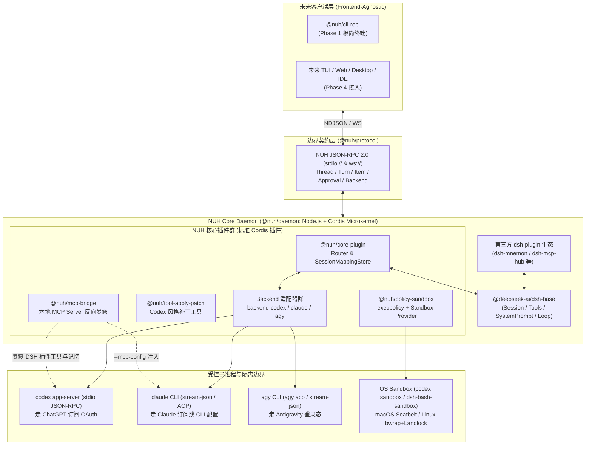
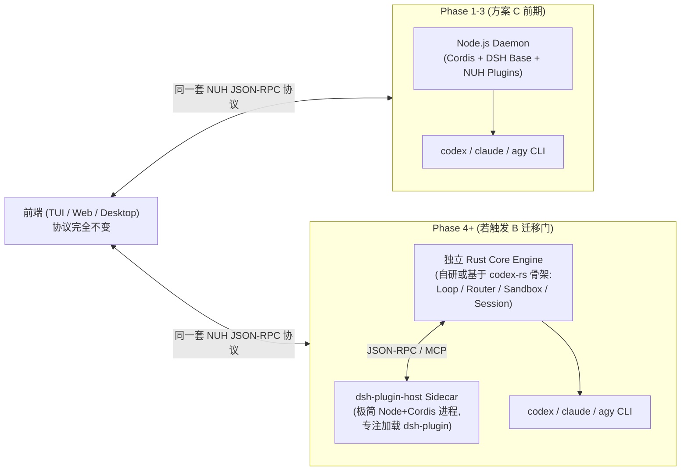

# NUH 系统架构与模块详细设计（方案 C）

> 本文档定义 NUH 在 **方案 C（协议隔离 + DSH/Cordis 微内核底座 + 可演进至独立引擎）** 下的各层架构、模块边界、数据流与故障恢复机制。

---

## 1. 核心架构分层图



---

## 2. DSH / Cordis 集成与插件兼容机制

### 2.1 为什么不改 DSH 核心源码即可扩展 NUH
DSH 基于 **Cordis** 的“Everything is a Plugin”与 **Three-Role Seams（角色 / 实现 / 消费者分离）** 架构：
- 已知核心上下文服务（`ctx.*`）包括：`ctx.tools`（工具注册中心）、`ctx.llm`（模型适配器）、`ctx.agents`（Agent Loop 与发起器）、`ctx.sessions`（持久化会话）等；装配通过 `cordis.patch.yml` 的 `id` 定位与 `!!js` 动态表达式完成（具体包内部导出名需在 Phase 0 Spike 0.1 中核实锁定）。
- **NUH 的插件加载策略**：
  1. 启动 `@nuh/daemon` 时，加载 `@deepseek-ai/dsh-base` 作为底层服务提供方；
  2. 通过 `profiles/default/cordis.patch.yml` 声明挂载 NUH 自己的插件（`@nuh/core-plugin`、`@nuh/policy-sandbox`、`@nuh/mcp-bridge` 等）；
  3. 用户安装的任意第三方 `dsh-plugin`（无论来自 npm、GitHub 还是本地 `link:`）直接写入用户配置目录的 `cordis.patch.yml`，Cordis 会自动将其注册进 `ctx.tools`、`ctx.on(...)` 与 `ctx.effect(...)` 生命周期中。

### 2.2 确保 `dsh-plugin` 100% 兼容的三条红线
1. **服务契约只增不改**：绝不更改 `dsh-base` 已有服务的字段签名（如 `ctx.tools.register`）。NUH 新增能力挂在独立命名空间（如 `ctx.nuhRouter`、`ctx.nuhPolicy`）。
2. **UI 服务安全桩（Headless Stub）**：部分社区 `dsh-plugin` 可能会声明依赖或检测 Web UI 相关可选服务。在无头模式下，若发现此类插件报错，通过一个轻量的 `@nuh/ui-stub` Cordis 插件提供无操作（No-op）或协议转发桩，避免插件挂载失败。
3. **隔离补丁原则**：如果实测发现 `dsh-base` 存在必须修复的 Bug 或缺少关键中断钩子，仅允许使用 `pnpm patch` 维护最小补丁并同步向 `deepseek-ai/deepseek-harness` 提交 PR。

---

## 3. 多后端统一抽象（`AgentBackend`）

NUH 将“本地直接跑 API（DSH Loop）”与“外部 CLI 子进程（Codex / Claude / AGY）”抽象为同构的执行后端：

### 3.1 核心接口模型（TypeScript 概念设计）

```ts
export type BackendKind = 'native-dsh' | 'codex' | 'claude' | 'agy';

export interface BackendCapabilities {
  supportsStreamingDelta: boolean;
  supportsServerApproval: boolean;   // 是否能把工具审批回调给 NUH
  supportsMcpInjection: boolean;     // 是否支持反向注入 NUH MCP 工具
  supportsSessionResume: boolean;    // 是否支持断点续聊
  supportsWorktreeIsolation: boolean;
}

export interface AgentBackend {
  readonly kind: BackendKind;
  healthCheck(): Promise<{ available: boolean; authenticated: boolean; version?: string; reason?: string }>;
  capabilities(): BackendCapabilities;

  startThread(opts: { workdir: string; model?: string; sandboxMode: SandboxMode; mcpEndpoints?: McpEndpoint[] }): Promise<{ backendThreadId: string }>;
  resumeThread(backendThreadId: string, opts: { workdir: string }): Promise<void>;

  runTurn(params: {
    backendThreadId: string;
    input: string;
    attachments?: Attachment[];
    signal: AbortSignal;
    onEvent: (ev: NuhUnifiedEvent) => void;
    onApprovalRequest: (req: ApprovalRequest) => Promise<ApprovalDecision>;
  }): Promise<TurnResult>;
}
```

### 3.2 四类后端的具体实现策略

| 后端标识 | 底层进程 / 引擎 | 鉴权与额度来源 | 会话恢复机制 | 审批接管方式 | MCP 注入方式 |
| :--- | :--- | :--- | :--- | :--- | :--- |
| **`native-dsh`** | 宿主机 Cordis + DSH Agent Loop | `.credentials.yaml` / Env（OpenAI / Anthropic / DeepSeek / Gemini API） | DSH 原生 `ctx.sessions` 持久化日志 | DSH 原生工具审批钩子 + `execpolicy` | 原生直接调用全部 `ctx.tools`，无需跨进程 |
| **`codex`** | `codex app-server --listen stdio://` | 复用本机 `codex login` 的 **ChatGPT Plus/Pro 订阅 OAuth**（或 Codex 配置的 API） | `thread/resume`（传递 Codex `threadId`） | 拦截 `app-server` 服务端下发的审批请求，透传给 NUH 客户端 | 通过动态 `-c mcp_servers.<name>=...` 或托管配置挂载 `@nuh/mcp-bridge` |
| **`claude`** | `claude --input-format stream-json --output-format stream-json --verbose`（或 `claude-agent-acp`） | 复用本机 `claude` CLI 登录态（Pro/Max 订阅或 API） | `--resume <claude_session_id>` | `--permission-prompt-tool stdio` 将权限确认重定向至 NUH | `--mcp-config <temp_json_path>` 动态注入 `@nuh/mcp-bridge` |
| **`agy`** | 主：`agy acp`（JSON-RPC over stdio）<br/>备：`agy -p ... --output-format stream-json` | 复用 `~/.gemini/antigravity-cli/settings.json` 与终端登录缓存 | ACP Session 句柄（长驻进程内保持）；降级模式下由 NUH 拼接摘要上下文 | ACP 权限回调 / 降级模式下预设只读或显式提示 | 优先复用 AGY 全局 MCP 配置或 ACP 扩展（Phase 0 验证具体能力） |

### 3.3 跨后端上下文连续性（`SessionMappingStore`）
当用户在同一个 NUH Thread 中从 `native-dsh` 切换到 `codex`，或再委派给 `claude` 时，不同后端的内部历史并不天然互通。NUH 通过两层机制解决：
1. **统一主账本（Canonical Ledger）**：所有后端产生的 `UserMessage`、`AssistantMessage`、`ToolCallSummary`、`FilesChanged` 均按统一结构追加写入 `~/.nuh/threads/<nuh_thread_id>/ledger.jsonl`。
2. **切换交接包（Handoff Context）**：当某后端首次在某个 `nuh_thread_id` 上启动时，Router 自动从 `ledger.jsonl` 提取**最新摘要 + 最近 N 轮关键变更文件路径**作为首轮系统前导上下文注入；同一后端后续再调用时则直接 `resume` 其自身的 `backendThreadId`，避免重复消耗 Token。

---

## 4. `@nuh/mcp-bridge` 反向工具注入设计

**解决痛点**：用户希望“`dsh` 插件直接用到 NUH 里面”，但当某轮对话路由给 `codex app-server` 或 `claude` CLI 时，这两个子进程跑在 Node.js/Cordis 之外，看不到 `ctx.tools`。

**工程方案**：
1. `@nuh/mcp-bridge` 订阅 Cordis 的 `ctx.tools` 变更事件（剔除与 CLI 自身重复的基础文件/Bash 工具，避免工具名冲突与上下文膨胀，只暴露**增值插件工具**，例如 `mnemon_recall`、`mnemon_store`、自定义 GitHub/数据库/领域工具）。
2. 在 NUH Daemon 进程内启动一个**仅监听 `127.0.0.1` 随机空闲端口 + Bearer Token 校验**的 Streamable HTTP MCP Server（或通过轻量 stdio-to-socket 代理命令启动）。
3. 启动 `codex` / `claude` 子进程时，将 `@nuh/mcp-bridge` 注册为名为 `nuh_host` 的 MCP Server，从而让外部 CLI 后端也能实时调用 Cordis 插件生态。

---

## 5. 安全策略与沙箱双层防线（`@nuh/policy-sandbox`）

对齐 Codex 的全面性，NUH 建立“**命令策略前置判定 + OS 内核沙箱兜底**”两道防线：

### 5.1 第一道防线：`execpolicy` 规则判定
- 规则文件支持三级覆盖：内置默认安全基线 → 用户全局 `~/.nuh/execpolicy.rules` → 项目级 `.nuh/execpolicy.rules`。
- 判定动作：
  - `allow`：安全只读/测试命令（如 `ls`、`rg`、`git status`、`git diff`、`pnpm test`）直接放行；
  - `prompt`：状态变更或外网访问命令（如 `git push`、`npm install`、`curl`）触发 `approval/requested`；
  - `forbid`：高危破坏性命令直接拒绝并向模型返回明确策略原因。
- 实施策略：Phase 3 可直接解析/复用 Codex 的规则语义，或调用兼容子命令检查，确保规则行为一致。

### 5.2 第二道防线：OS 沙箱执行器
- **模式分级**：`read-only`（仅允许读工作区与执行无害检查）、`workspace-write`（仅允许写当前工作区与 `/tmp`，默认禁止直连公网）、`danger-full-access`（仅在显式授权或提权重试后开启）。
- **macOS / Linux 实现**：
  - 优先复用 DSH 自带的 `@deepseek-ai/dsh-bash-sandbox`；
  - 在需要更严格的网络禁用与拒绝日志回传时，利用 `codex-cli` 自带的 `codex sandbox`（实测支持 `--sandbox-state-disable-network` 与 `--log-denials`）包装执行命令，并将 macOS Seatbelt denial 摘要反馈给 Agent，让模型明白“是沙箱拒绝了写 `/etc` 或外网连接”，从而主动发起提权申请或修正命令。

---

## 6. 进程守护、取消与崩溃恢复

1. **进程生命周期管理**：所有子进程（`codex app-server`、`claude`、`agy`）均由 `@nuh/daemon` 的 `ProcessSupervisor` 托管，绑定父进程退出信号（`SIGINT` / `SIGTERM` / `exit`），防止孤儿进程残留。
2. **中断语义（`turn/interrupt`）**：
   - `native-dsh`：触发 `AbortController.abort()` 中断流式请求与子命令；
   - `codex`：发送 `app-server` 对应的取消/中断请求；
   - `claude` / `agy`：发送控制中断帧或 `SIGINT`（仅限当前 Turn，不破坏会话持久化 ID）。
3. **崩溃自愈**：若 `codex app-server` 意外崩溃退出，Supervisor 标记当前 Turn 失败并向客户端发送结构化错误通知，同时在下次 `turn/start` 时自动拉起新实例并执行 `thread/resume`。

---

## 7. Phase 4 向方案 B（独立核心引擎）的演进路径



通过此设计，**方案 A（借鸡生蛋）与方案 B（长期可控）之间不再是非此即彼的推翻重来，而是一次标准的跨进程边界替换**。
