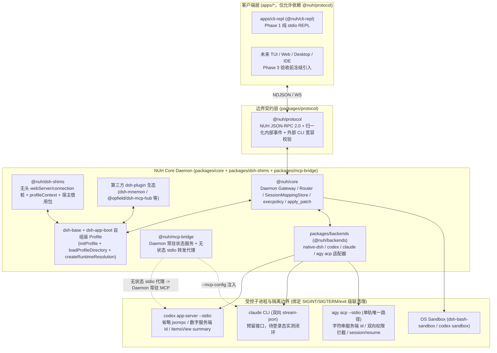

# NUH 系统架构与模块详细设计（方案 C）

> 本文档定义 NUH 在 **方案 C（协议隔离 + DSH/Cordis 微内核底座 + 可演进至独立引擎）** 下的各层架构、模块边界、数据流与故障恢复机制，已对齐 Phase 0 Spike 01/02/04/05 实测结论与实际仓库目录。

---

## 1. 核心架构分层图

---

## 2. DSH / Cordis 无头自组装与插件兼容机制

### 2.1 基于 `dsh-base + dsh-app-boot` 自组装（Spike 02 实测锁定）
- **放弃 `dsh-headless` / `dsh-sdk-minimal` / `dsh-acp-app`**：实测三者在脱离 `dsh` CLI 启动器时均因缺少 `cmdlineArgs` 服务抛出 `StartupError`，且 `dsh-headless` 会级联阻塞 `fs`、`shell`、`bash-sandbox` 等 22 个条目。
- **自组装启动链路**：`@nuh/core` 直接通过 `@deepseek-ai/dsh-app-boot` 的 `initProfile` + `loadProfileDirectory` + `createRuntimeResolution` + `PluginPackages` 加载锁定版本的 `@deepseek-ai/dsh-base@0.2.2-rc.1`（`cordis.yml` 须位于 `$DSH_HOME/profiles/<name>/` 下以触发运行时模块解析劫持）。
- **构建白名单**：根 `pnpm-workspace.yaml` 显式声明 Spike 02 实测的 5 个 `allowBuilds` 包（`@deepseek-ai/dsh-subprocess-local: true`，其余预编译二进制/无须构建包显式置为 `false`）。

### 2.2 `@nuh/dsh-shims` 兼容桩与三条红线
1. **服务契约只增不改**：绝不复制、Fork 或更改 `@deepseek-ai/dsh-base` 源码与已有服务签名。
2. **无头插件服务桩（`@nuh/dsh-shims`）**：
   - 针对 `dsh-mnemon@0.5.45`：提供最小 `profileContext` 并启用 `settings`（同时保持 `hmr` 禁用以避免 `Profile HMR requires application readiness` 报错），等待 `loader?.await?.()` 完成后再释放上下文。
   - 针对 `@opfield/dsh-mcp-hub@0.4.2`（注意无 scope 的 `dsh-mcp-hub@0.0.1` 为空占坑包）：提供最小 `ctx.webServer.register` 与 `ctx.connection.requestRejection` 桩，并在宿主依赖树补齐其 `install.js` 借用的 5 个 `@deepseek-ai/*` / `@modelcontextprotocol/client` 包（`@deepseek-ai/*` 必须锁定精确版本号）。
3. **测试伴随**：所有 `@nuh/dsh-shims` 补丁均须附带明确的回归测试。

---

## 3. 多后端统一抽象（`AgentBackend`）

所有后端适配器统一收口在 `packages/backends`（`@nuh/backends`），**严禁向核心调度层泄漏各自私有的 CLI 输出格式**，必须先经 `@nuh/protocol` 校验并转换为 `NuhNormalizedEvent` 后上送。

### 3.1 四类后端的实际协议与适配策略

| 后端标识 | 底层进程 / 引擎 | 鉴权与额度来源 | 会话恢复机制 | 审批接管与协议实测坑点 |
| :--- | :--- | :--- | :--- | :--- |
| **`native-dsh`** | 宿主机 Cordis + `dsh-base` Loop | `.credentials.yaml` / Env | DSH 原生 `ctx.sessions` | DSH 原生审批钩子 + `execpolicy`；直接消费 `ctx.tools` |
| **`codex`** | `codex app-server --stdio` | 本机 `codex login` ChatGPT 订阅 OAuth | `thread/resume` | **Spike 01 坑点**： 1. 下行报文**省略 `"jsonrpc": "2.0"`**，须宽容解析； 2. 服务端 `id` 从 `0` 递增独立命名空间，必须优先检测 `id !== undefined && method !== undefined`； 3. 含 `emittedAtMs`、`availableDecisions` 等扩展字段，Zod 校验必须启用 `.passthrough()`； 4. `turn/completed` 仅含 `itemsView: "summary"`，必须订阅流式 `item/*` 归档完整日志 |
| **`agy`** | **单轨锁定 `agy acp --stdio`**（已删除 `-p stream-json` 降级路径） | 本机 Antigravity OAuth（`settings.json`） | 进程内长驻 + 跨进程 `session/resume` | **Spike 04 坑点**： 1. 服务端 `session/request_permission` 请求 `id` 为**字符串 `"1"`**（异构 `number \| string`）； 2. `agentCapabilities` 混用驼峰与下划线键名，须 `.passthrough()`； 3. `deny` 后可能直接返回 `stopReason: "end_turn"` 而无 `agent_message_chunk`，归一化层须依据 `tool_call_update(status="failed")` 输出拒绝反馈 |
| **`claude`** | `claude --input-format stream-json --output-format stream-json --verbose` | 本机 `claude` 登录态（目前本机未登录，留接口） | `--resume <session_id>` | `--permission-prompt-tool stdio`；待具备有效登录态后补齐真实抓包 Fixtures 与契约测试 |

### 3.2 跨后端上下文连续性（`SessionMappingStore`）
- **统一主账本（Canonical Ledger）**：所有后端归一化后的 `UserMessage`、`AssistantMessage`、`ToolCallSummary`、`FilesChanged` 统一写入 `~/.nuh/threads/<nuh_thread_id>/ledger.jsonl`。
- **切换交接包（Handoff Context）**：跨后端首次接手同一 `nuh_thread_id` 时注入最新摘要与变更文件列表；同后端复用直接调用 `thread/resume`（Codex）或 `session/resume`（AGY ACP）。

---

## 4. `@nuh/mcp-bridge` 状态常驻 Daemon 设计（Spike 05 实测修正）

Spike 05 实测证明：`codex app-server` 在一次生命周期中会**先后拉起多个**独立的 `stdio` MCP 子进程（先拉起 1 个执行 `mcpServerStatus/list` 探测，再为 `thread/start` 拉起第 2 个执行 `tools/call`）。

因此 `@nuh/mcp-bridge` 采用**两段式架构**：
1. **状态与工具宿主常驻 Daemon**：在 `@nuh/core` Daemon 进程内监听仅限 `127.0.0.1` 的本地服务（带启动期生成的随机 Bearer Token），实时订阅 Cordis `ctx.tools` 变更并持有全部插件状态与记忆上下文。
2. **无状态 `stdio` 转发代理**：注入给 `codex`（`-c mcp_servers.<name>=...`）或 `claude`（`--mcp-config`）的 `stdio` 入口保持完全无状态，只负责将 MCP 请求转发至 Daemon 内核端点，彻底消除多进程拉起导致的工具状态分叉。

---

## 5. 安全策略与双层防线

1. **第一道防线：`execpolicy` 命令策略引擎**（`allow` / `prompt` / `forbid` 三态判定），作用于 `native-dsh` 与所有发出服务端审批请求的 CLI 后端。
2. **第二道防线：OS 沙箱执行器**（`read-only` / `workspace-write` / `danger-full-access`），结合 `dsh-bash-sandbox` 与 `codex sandbox`（待 Phase 3 前完成 Spike 03 验证）。

---

## 6. 进程守护、取消与崩溃自愈

1. **级联退出清理**：所有托管 CLI 子进程（`codex`、`claude`、`agy`）必须显式绑定父进程 `SIGINT` / `SIGTERM` / `exit` 清理钩子，先关 `stdin` 再发 `SIGTERM` 并配 `SIGKILL` 兜底定时器；`stderr` 仅用于结构化日志记录，严禁混入 JSON-RPC 解析流。
2. **单轨崩溃恢复（不降级至 `-p`）**：
   - `codex app-server` 意外退出 → 标记当前 Turn 失败并上报错误码，下次交互重启进程并调用 `thread/resume`。
   - `agy acp --stdio` 意外退出 → 标记当前 Turn 失败并上报错误码，下次交互重启 `agy acp --stdio` 并调用 `session/resume`（**绝不降级到无权限拦截能力的 `agy -p stream-json`**）。
3. **无静默降级**：禁止使用 `try { ... } catch { return null }` 吞掉协议解析或子进程异常，所有失败必须转换为 `@nuh/protocol` 定义的标准 JSON-RPC Error Code。
